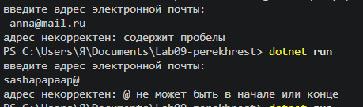
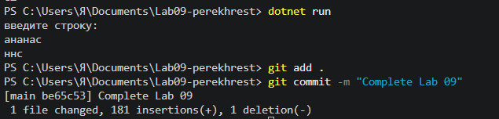

# Практическая работа №9

**ФИО:** Перехрест Саша
**Группа:** ИСП-242
**Дата:** 29.10.2026

## Что изучено

- Строка в C# - неизменяемый объект: методы `ToUpper()`, `ToLower()`, `Replace()`, `Substring()` возвращают **новую** строку, а исходная не меняется. Поэтому результат нужно сохранять в переменную, иначе вызов `text.ToUpper()` без присваивания ни на что не влияет.
- Строку можно перебирать по индексу (как массив) и через `foreach`; индексы начинаются с нуля, а `s[s.Length - 1]` даёт последний символ.
- Методы `Contains`, `StartsWith`, `EndsWith` позволяют проверять содержимое строки и возвращают `bool`, что удобно для условий `if/else if`.

## Скриншоты

